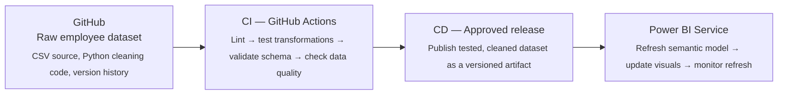
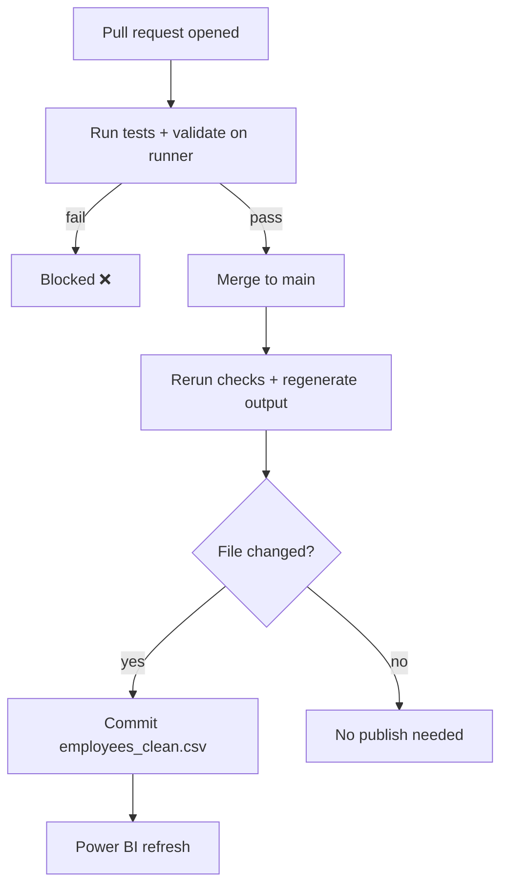

# End-to-End CI/CD: Employee Dataset and Power BI Dashboard

A beginner-friendly, end-to-end project that shows how to apply **CI/CD** to a data pipeline: clean an employee dataset with Python, test it automatically with **GitHub Actions** and **pytest**, publish a production-ready CSV, and serve it to a **Power BI** dashboard.


---

## Table of contents

- [What is CI/CD?](#what-is-cicd)
- [Architecture](#architecture)
- [Tools](#tools)
- [Repository structure](#repository-structure)
- [Getting started](#getting-started)
- [How the workflow runs](#how-the-workflow-runs)
- [Configuration notes](#configuration-notes)
- [Why a sample test dataset?](#why-a-sample-test-dataset)
- [Roadmap](#roadmap)

---

## What is CI/CD?

**CI/CD** stands for **Continuous Integration** and **Continuous Delivery/Deployment**.

Imagine a data pipeline that downloads employee data from GitHub, combines it with weather data from PostgreSQL, processes it in Databricks, and produces tables for Power BI. It works on your computer — but what happens when you change the code? How do you know you haven't broken the pipeline? How do you safely move those changes into production?

CI/CD provides a **repeatable process** for handling these challenges.

### CI — Continuous Integration

Every time you submit code changes, an automated process checks your code, runs tests, and identifies problems early.

> **Example:** Check whether your Python transformation code runs and produces the expected results.

### CD — Continuous Delivery or Deployment

After the code passes its checks, the process of preparing and releasing it to the next environment is automated.

> **Example:** Deploy Databricks notebook or Azure Data Factory pipeline changes to a test environment, then promote them to production.

| Term | Meaning |
|---|---|
| **Continuous Delivery** | Changes are tested and prepared for release, but a person may approve the production deployment. |
| **Continuous Deployment** | Every change that passes the required checks is deployed to production automatically. |

---

## Architecture



- **Stage 1:** GitHub Actions automatically tests and cleans the dataset, then publishes a production-ready CSV.
- **Stage 2:** Power BI consumes the published dataset and refreshes automatically, with deployment approval and monitoring where supported.

The first version uses only **GitHub Actions + Power BI** — no Azure Data Factory or Databricks required. Those can be added as the project grows.

---

## Tools

You don't need to learn every CI/CD tool at once. Start with one tool for version control and one for automation.

| Tool | What it's used for | Used in v1 |
|---|---|:---:|
| **Git** | Track changes to your code | ✅ |
| **GitHub** | Store code and collaborate | ✅ |
| **GitHub Actions** | Run automated tests and workflows | ✅ |
| **pytest** | Test Python transformation logic | ✅ |
| Azure Data Factory | Orchestrate ingestion and data movement | Later |
| Azure Databricks | Process data using PySpark | Later |
| Databricks Declarative Automation Bundles | Deploy Databricks code, jobs and configuration consistently | Later |
| Azure DevOps | Alternative platform for automated deployment | Optional |

**Starting stack:** Git + GitHub + GitHub Actions + pytest. Azure Data Factory and Databricks deployment are added once the fundamentals work.

---

## Repository structure

```text
employee-analytics/
├── data/
│   ├── raw/
│   │   └── employees.csv
│   └── processed/
│       └── employees_clean.csv
├── src/
│   └── clean_employees.py
├── tests/
│   └── test_clean_employees.py
├── .github/
│   └── workflows/
│       └── employee-pipeline.yml
├── requirements.txt
├── .gitignore
└── README.md
```

| Component | Purpose |
|---|---|
| `data/raw/employees.csv` | Original employee data, preserved as the source |
| `src/clean_employees.py` | Python cleaning and transformation logic |
| `tests/` | Automated checks for the cleaning logic and output |
| `.github/workflows/employee-pipeline.yml` | Instructions that GitHub Actions executes |
| `data/processed/employees_clean.csv` | Cleaned dataset that Power BI consumes |

---

## Getting started

1. **Create a project folder** on your computer named `employee-analytics`.
2. **Clone the repository** (or initialise a new one):

   ```bash
   git clone https://github.com/Kindoli/End-to-End-CI-CD-Employee-Dataset-and-Power-BI-Dashboard
   cd employee-analytics
   ```

3. **Install dependencies:**

   ```bash
   pip install -r requirements.txt
   ```

4. **Run the cleaning script locally:**

   ```bash
   python src/clean_employees.py
   ```

5. **Run the tests:**

   ```bash
   pytest
   ```

6. **Connect Power BI** to the published `data/processed/employees_clean.csv` (for example, via its raw GitHub URL) and configure a scheduled refresh in the Power BI Service.

---

## How the workflow runs

| Step | Trigger | What happens |
|---|---|---|
| **A. Pull request opened** | PR to `main` | GitHub runs unit tests, creates a cleaned dataset on the temporary runner, and validates it. Nothing is published to `main`. |
| **B. Tests must pass** | Each check | A missing column, invalid identifier or failing unit test **blocks** the deployment job. |
| **C. Approved change reaches `main`** | Merge / push | GitHub Actions reruns the checks, then regenerates the cleaned output. |
| **D. Cleaned dataset published** | After checks pass | If the file has changed, the workflow commits the new `employees_clean.csv` to the repository. |



---

## Configuration notes

- **Write permissions:** The workflow needs repository write permission to publish the output. If branch protection prevents bot pushes, publish a **release artifact** or open a **controlled pull request** instead.
- **No infinite loops:** GitHub's built-in `GITHUB_TOKEN` generally does not trigger another push workflow when it pushes the generated file, which prevents the workflow from re-triggering itself.

---


## Roadmap

- [x] Version control with Git and GitHub
- [x] Automated tests with pytest and GitHub Actions
- [x] Publish cleaned dataset for Power BI
- [ ] Add Azure Data Factory for ingestion and orchestration
- [ ] Add Azure Databricks (PySpark) processing
- [ ] Deploy Databricks resources with Declarative Automation Bundles
- [ ] Add test → production environment promotion with approvals
